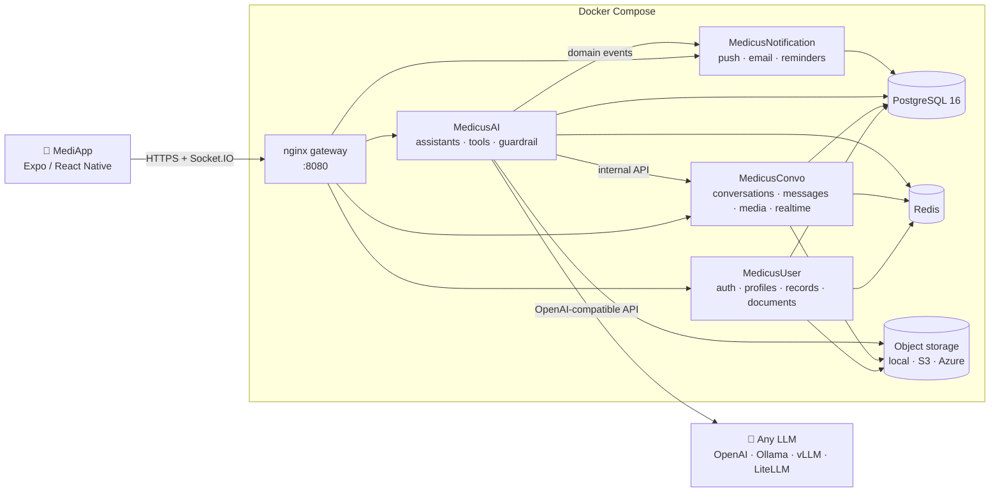

<div align="center">

# Medicus

**An open-source, AI-assisted healthcare platform that connects patients and doctors, with any LLM you choose.**

Patients chat with an assistant that knows their health record. Doctors chart, prescribe and book by talking to theirs. You decide which model runs it: OpenAI, Anthropic, Gemini, or a local model on your own hardware through Ollama or vLLM.

[](LICENSE)
[](https://www.python.org/)
[](https://www.postgresql.org/)
[](https://expo.dev/)
[](docker-compose.yml)
[](CONTRIBUTING.md)

[Features](#features) · [Quick start](#quick-start) · [Choosing a model](#choosing-a-language-model) · [Architecture](#architecture) · [Configuration](#configuration) · [Contributing](#contributing)

</div>

> [!IMPORTANT]
> Medicus is **not a medical device** and does not replace professional medical judgement. It ships with security controls for health data, but it is **not certified** for HIPAA, GDPR or any other regulatory regime out of the box. If you deploy it with real patients, compliance is your responsibility. See [Security](#security).

---
<div align="center">
  <video src="https://github.com/user-attachments/assets/22c482c4-e532-4997-9add-552726aba9f9" width="100%" controls></video>
</div>

## Table of contents

- [Why Medicus](#why-medicus)
- [Features](#features)
- [Quick start](#quick-start)
- [Choosing a language model](#choosing-a-language-model)
- [Doctor knowledge base (RAG)](#doctor-knowledge-base-rag)
- [Running the mobile app](#running-the-mobile-app)
- [Architecture](#architecture)
- [Project structure](#project-structure)
- [Configuration](#configuration)
- [Database](#database)
- [Testing](#testing)
- [Security](#security)
- [Roadmap](#roadmap)
- [Contributing](#contributing)
- [Main contributors](#main-contributors)
- [License](#license)

## Why Medicus

Most AI health assistants are closed products that send your data to a single vendor. Medicus takes the opposite approach:

- **Bring your own model.** Every AI feature goes through one provider-neutral layer. Switch from GPT to Claude to a local Qwen model by changing environment variables, not code.
- **Self-host anywhere.** Plain PostgreSQL, Redis and Docker. No cloud account is required: storage, email and push notifications all have local or self-hosted options.
- **Grounded answers.** Assistants don't guess. They call tools that read the patient's actual record (vitals, conditions, medications, visits) and write back to it in a structured, auditable way.
- **Security by construction.** The model never decides *whose* data it touches. Patient and doctor identity are resolved on the server and injected into every tool call.

## Features

### For patients: the **MediAid** assistant
- Ask about your own record in plain language: latest vitals, active conditions, current medications, upcoming procedures and exams.
- Find a doctor's free slots and book, reschedule or cancel appointments in conversation.
- Message your doctor directly, with real-time delivery over Socket.IO.
- Send voice notes (speech-to-text) and attachments such as lab reports and PDFs, which the assistant reads and explains.
- **Talk to Sara live:** a hands-free voice conversation with the same assistant, tools and records as the chat. Both sides are saved in the conversation.
- **MediExplain:** a plain-language summary of what your doctor discussed.
- A personal document vault, with documents you can share with your doctor in a conversation.
- Manage dependents (children, parents) under one account.
- An emergency triage protocol and support tickets.

### For doctors: the **MediDoc** assistant
- Chart by conversation: record vitals, diagnoses, SOAP notes, prescriptions, exam orders and results, and procedures.
- Correct records safely: notes and procedures are *superseded* or *invalidated*, never silently overwritten.
- **MediBrief:** an on-demand clinical summary of a patient thread.
- An agenda across all patients, conversation search, and practice performance metrics.
- A public profile: specialties, working hours, locations, procedures and pricing.
- **MediKnowledge:** publish your own material (procedure explanations, preparation guides, fees, insurance, clinic policies) as PDF, TXT or Markdown. Your patients' assistant answers their questions from it and names the document, instead of from general knowledge.

### Platform
- **Model-agnostic AI layer:** OpenAI, any OpenAI-compatible server (Ollama, vLLM, LM Studio, llama.cpp, OpenRouter, Groq, Together, Azure OpenAI) or 100+ providers through LiteLLM (Anthropic, Gemini, Bedrock, Mistral and more), with a different model per task if you want.
- **Prompt-injection guardrail** on every user turn (optional).
- **Notifications:** Expo push, Firebase Cloud Messaging and email, with quiet hours, per-category preferences, retries, and appointment reminders 24 hours and 2 hours before.
- **Pluggable storage:** local disk, S3-compatible (AWS, MinIO, Cloudflare R2) or Azure Blob, served through short-lived signed URLs.
- **Pluggable email:** SMTP, Azure Communication Services, or console output for development.

## Quick start

**Prerequisites:** [Docker](https://docs.docker.com/get-docker/) with Compose v2, about 4 GB of free RAM, and either an API key for a hosted model or [Ollama](https://ollama.com/) for a local one.

```bash
git clone https://github.com/ChadiHamrouni/Medicus-AI.git
cd Medicus-AI
cp .env.example .env
```

Generate the required secrets and paste them into `.env`. The services refuse to start while any value still begins with `CHANGE_ME`:

```bash
openssl rand -hex 32   # JWT_SECRET_KEY
openssl rand -hex 32   # INTERNAL_API_KEY
openssl rand -hex 16   # POSTGRES_PASSWORD
```

Choose a language model in `.env` (see [Choosing a language model](#choosing-a-language-model)), then start the stack:

```bash
docker compose up -d --build                          # database, migrations, services, gateway
docker compose --profile demo run --rm seed-demo      # optional: demo doctor & patient
```

Compose builds the backend images and installs the shared `MedicusCommon`
package inside them; no separate package installation is needed for this
workflow. For individual image builds, source-based backend development, or
building the Expo app, see [Building from source](./BUILDING.md).

| URL | What |
|---|---|
| `http://localhost:8080` | API gateway: point the mobile app here |
| `http://localhost:8025` | Mailpit: every email the stack sends in development |

**Demo accounts** (only when you loaded `seed-demo`; never in production):

| Role | Email | Password |
|---|---|---|
| Doctor | `doctor@example.com` | `MedicusDemo123!` |
| Patient | `patient@example.com` | `MedicusDemo123!` |

Check that everything works:

```bash
./scripts/e2e.sh                  # 164 end-to-end tests, no LLM needed
```

## Choosing a language model

All AI features read the same few variables. Pick one option.

<details open>
<summary><b>A. OpenAI</b></summary>

```env
LLM_PROVIDER=openai
LLM_API_KEY=sk-...
```
Default models for each task are set in `MedicusCommon/medicus_common/core/config.json`.
</details>

<details>
<summary><b>B. Local models with Ollama</b> (no data leaves your machine)</summary>

Pull a model that supports **tool calling** (for example from the Qwen 3, Llama 3.1+ or Mistral families):

```bash
ollama pull qwen3.5:4b
```

Then pick where Ollama runs:

| Ollama runs… | `LLM_BASE_URL` |
|---|---|
| Natively on your machine (typical on macOS and Windows, uses the GPU) | `http://host.docker.internal:11434/v1` |
| Inside the stack: `docker compose --profile ollama up -d` | `http://ollama:11434/v1` |

```env
LLM_PROVIDER=openai_compatible
LLM_BASE_URL=http://host.docker.internal:11434/v1
LLM_API_KEY=ollama
LLM_MODEL=qwen3.5:4b
LLM_REASONING_EFFORT=none
LLM_SUPPORTS_VISION=false
```

> [!TIP]
> **Raise Ollama's context window to 64K tokens** (Ollama settings, or `OLLAMA_CONTEXT_LENGTH=65536`). The default of 4K is far too small: the doctor assistant's prompt, with its tools, is around 30K tokens, and Ollama **silently truncates** anything longer. See *Context length matters* below.
>
> Set `LLM_REASONING_EFFORT=none` for "thinking" models (Qwen 3, DeepSeek-R1, gpt-oss). Otherwise their hidden reasoning can use up the whole output budget and the reply comes back empty.

The same settings work for **vLLM, LM Studio, llama.cpp server, LocalAI, OpenRouter, Groq and Together**. Only the base URL and model name change.
</details>

<details>
<summary><b>C. Anthropic, Gemini, Bedrock, Mistral… via LiteLLM</b></summary>

```env
LLM_PROVIDER=litellm
LLM_MODEL=anthropic/claude-sonnet-4-5
ANTHROPIC_API_KEY=...
AI_COMMON_EXTRAS=ai,litellm      # build-time: installs LiteLLM into the AI service
```
</details>

**Per-task models.** Each AI task has a role, and any role can use its own model, for example a large model for the assistant and a small one for summaries:

| Variable | Used for |
|---|---|
| `LLM_MODEL_TOOLS` | The assistants themselves. **Must support tool calling.** |
| `LLM_MODEL_GUARDRAIL` | Prompt-injection screening |
| `LLM_MODEL_SUMMARY` / `LLM_MODEL_TEXT` | MediBrief, MediExplain, conversation compaction |
| `LLM_MODEL_VISION` / `LLM_MODEL_DOC` / `LLM_MODEL_LAB` / `LLM_MODEL_TRIAGE` | Attachment analysis |
| `EMBEDDING_MODEL` | Optional embeddings for MediKnowledge search (any `/v1/embeddings` server, e.g. Ollama `nomic-embed-text`). Without it, search uses PostgreSQL full-text only. |
| `LLM_MODEL_VOICE` | The assistant during live voice conversations (and its guardrail). Use a model that fits on the GPU next to the speech model. **Must support tool calling.** |

A role without its own variable falls back to `LLM_MODEL`.

**Speech.** Voice notes (speech-to-text) and live voice conversations (speech-to-text and text-to-speech) work with any server that implements `/v1/audio/transcriptions` and `/v1/audio/speech`: faster-whisper, Kokoro, LocalAI, or Ollama itself with an audio model. One Ollama model can do both directions:

```env
STT_BASE_URL=http://host.docker.internal:11434/v1
STT_MODEL=lfm3-omni
TTS_BASE_URL=http://host.docker.internal:11434/v1
TTS_MODEL=lfm3-omni
TTS_VOICE=female-american-english
```

Recordings are converted to 16 kHz mono WAV before transcription. A live voice turn is speech-to-text, then the conversation's assistant (same tools, guardrail and records as typed chat), then text-to-speech streamed back sentence by sentence, over a WebSocket (`/api/MedicusAI/live/voice`). No feature depends on a hosted vendor.

> **Live voice on one consumer GPU:** for answers within a few seconds, the speech model and the voice assistant model must both stay loaded. With Ollama, set `OLLAMA_MAX_LOADED_MODELS=2` and pick an `LLM_MODEL_VOICE` small enough to fit next to the speech model (for example `qwen3.5:4b` with `lfm3-omni` on 8 GB). If `LLM_MODEL_VOICE` is the speech model itself, keep `OLLAMA_MAX_LOADED_MODELS=1` so the main chat model gets the whole GPU. Very small models answer fast but may skip tool calls.

> **Context length matters:** an assistant turn sends about 30,000 tokens (instructions plus every tool's schema; MediDoc has 35 tools). Ollama silently cuts longer prompts to its context window, and it divides that window between parallel requests (`OLLAMA_NUM_PARALLEL`, 2 by default). Set the context to **64k** (Ollama app settings or `OLLAMA_CONTEXT_LENGTH=65536`), or use 32k with `OLLAMA_NUM_PARALLEL=1`. With less, the model never sees its full instructions and tools: expect invented tool names, rejected arguments and answers that ignore the request. Check `server.log` for `truncating input prompt`.

## Doctor knowledge base (RAG)

**MediKnowledge** lets a doctor publish trusted material (how a procedure is done, preparation instructions, recovery, fees, insurance, clinic policies), and the doctor's assistant answers patients from it instead of from general knowledge. It lives in [`MedicusAI/src/tools/mediknowledge/`](MedicusAI/src/tools/mediknowledge/).

**How a patient's question is answered**

1. The doctor uploads a PDF, TXT or Markdown file, or pastes text: `POST /api/MedicusAI/knowledge/documents` (doctors only; also `GET` to list, `DELETE /{id}` to remove).
2. The text is extracted, cleaned, split into overlapping chunks and stored in PostgreSQL (`knowledge.documents`, `knowledge.chunks`), with optional embeddings.
3. On every patient turn in a conversation with that doctor, MedicusAI runs a **hybrid search** on the message (English full-text, prefix matching for other languages, and embedding similarity when configured, fused with reciprocal rank fusion) and adds the best excerpts to the assistant's context.
4. The assistant answers from those excerpts and names the document. It can search again with the `search_doctor_knowledge` tool. If the material doesn't cover the question, it says so instead of guessing. The tool always searches the conversation's own doctor, never another doctor's material.

| File | Role |
|---|---|
| `ingest.py` | extract → clean → chunk → embed → store, plus list and delete |
| `hybrid_search.py` | full-text + prefix + vector search, fused with RRF |
| `context.py` | adds the relevant excerpts to each patient turn |
| `knowledge.py` | the `search_doctor_knowledge` agent tool (MediAid, and the doctor's own assistant) |

It works without extra services: keyword search uses PostgreSQL alone. To also match by meaning, set an embedding model; any `/v1/embeddings` server works:

```env
EMBEDDING_MODEL=nomic-embed-text            # ollama pull nomic-embed-text
EMBEDDING_BASE_URL=http://host.docker.internal:11434/v1   # defaults to LLM_BASE_URL
```

**Elasticsearch ingestion pipeline**

`mediknowledge/ingestion/` holds a richer, multi-stage pipeline (`extracting` → `parsing` → `insights` → `storing`). It extracts text, images and tables from PDFs, has the LLM write a title and summary for each passage, embeds small "retriever" chunks that point to larger "generative" passages, and indexes both in Elasticsearch per country (`<country>_gen`, `<country>_ret`). Searching it (`mediknowledge/es_search.py`) runs keyword (BM25) and vector (kNN) rankings over the retriever chunks, merges them with reciprocal rank fusion, and returns the generative passages; every query is filtered to one doctor. The assistant still uses the PostgreSQL index; switching it over is on the roadmap.

```bash
docker compose --profile elasticsearch up -d elasticsearch     # needs about 1 GB of RAM
docker compose exec ai python -m src.tools.mediknowledge.cli ingest /path/guide.pdf --doctor 3 --country us --specialty 9
docker compose exec ai python -m src.tools.mediknowledge.cli search "Do I need to fast before my echo?" --doctor 3 --country us
docker compose exec ai python -m src.tools.mediknowledge.cli settings          # print the active settings
docker compose exec ai python -m src.tools.mediknowledge.cli reset --country us
```

**Tuning.** Every hyperparameter of both pipelines (supported file types, chunk sizes and overlaps, embedding dimension and batch size, index shards, replicas, similarity and HNSW parameters, `top_k`, candidates, RRF constant, ingestion LLM settings) lives in one commented file, [`mediknowledge/config/mediknowledge.toml`](MedicusAI/src/tools/mediknowledge/config/mediknowledge.toml). It is validated at startup (`config/settings.py`); point `MEDIKNOWLEDGE_CONFIG` at another file to swap configurations per environment. Index-level changes (dimension, similarity, HNSW, shards) apply to new indices: run `reset` and re-ingest. Connection settings stay in the environment:

```env
ELASTICSEARCH_URL=http://elasticsearch:9200   # default
EMBEDDING_DIMENSION=768                       # overrides the TOML; must match EMBEDDING_MODEL (nomic-embed-text: 768)
KNOWLEDGE_BUCKET_ROOT=                        # where ingestion tracking files go; default STORAGE_LOCAL_PATH/knowledge
MEDIKNOWLEDGE_CONFIG=                         # optional path to an alternative mediknowledge.toml
```

## Running the mobile app

The app is built with [Expo](https://expo.dev/) (React Native). It uses native modules (audio recording and playback), so it needs a **development build**; Expo Go is not enough.

```bash
cd MediApp
npm ci
cp .env.example .env.local
```

### Configuration

The app contains no hard-coded server address or website. Everything it needs comes from `EXPO_PUBLIC_*` environment variables, read in one place: [`MediApp/utils/infrastructure/env.ts`](MediApp/utils/infrastructure/env.ts). Expo inlines these values into the bundle at build time, so:

- **Local development:** put them in `MediApp/.env.local` (git-ignored). Restart Metro after changing it.
- **EAS builds:** store them as EAS environment variables, one set per profile (`development`, `preview`, `production`, already mapped in `eas.json`):
  ```bash
  eas env:create --environment production --name EXPO_PUBLIC_MEDICUS_API_BASE_URL --value https://api.example.org --visibility plaintext
  ```
- **Never put secrets in `EXPO_PUBLIC_*` variables:** anyone can read them from the app. Keys for LLMs, databases or internal APIs belong to the backend only.

| Variable | Required | Purpose |
|---|---|---|
| `EXPO_PUBLIC_MEDICUS_API_BASE_URL` | yes | API gateway; every service URL and Socket.IO derive from it |
| `EXPO_PUBLIC_MEDICUS_{USER,CONVO,AI}_API_BASE_URL`, `EXPO_PUBLIC_MEDICUS_NOTIFICATION_API_URL`, `EXPO_PUBLIC_SOCKETIO_URL` | no | Per-service overrides, only for services not behind the gateway |
| `EXPO_PUBLIC_WEBSITE_URL`, `EXPO_PUBLIC_TERMS_URL`, `EXPO_PUBLIC_PRIVACY_URL`, `EXPO_PUBLIC_SUPPORT_EMAIL`, `EXPO_PUBLIC_APP_STORE_URL`, `EXPO_PUBLIC_PLAY_STORE_URL` | no | Links and support contact in Settings > About, Help and Invite; hidden when unset |
| `EXPO_PUBLIC_SENTRY_DSN` | no | Crash reporting |
| `GOOGLE_MAPS_API_KEY`, `EXPO_OWNER`, `EAS_PROJECT_ID`, `APP_BUNDLE_ID` | no | Build-time only (read by `app.config.js`, not bundled) |

Set `EXPO_PUBLIC_MEDICUS_API_BASE_URL` to the gateway as the device sees it:

| Device | Base URL |
|---|---|
| Android emulator | `http://10.0.2.2:8080` |
| iOS simulator | `http://localhost:8080` |
| Physical phone (same Wi-Fi) | `http://<your-computer-LAN-IP>:8080` |

```bash
npx expo run:android      # or: npx expo run:ios   (macOS only)
```

> [!NOTE]
> Android builds need **JDK 17**. Newer JDKs, including the one bundled with recent Android Studio versions, are not supported by the project's Gradle version. Set `JAVA_HOME` to a JDK 17 install.

To publish your own build or over-the-air updates, set `EXPO_OWNER`, `EAS_PROJECT_ID` and `APP_BUNDLE_ID`; for maps, set `GOOGLE_MAPS_API_KEY`. See [`MediApp/.env.example`](MediApp/.env.example).

## Architecture



| Service | Responsibility |
|---|---|
| **MedicusUser** | Registration, login, JWT and refresh-token rotation, email verification, password reset, patient and doctor profiles, dependents, read APIs for the medical record, document vault |
| **MedicusConvo** | Conversations (patient and doctor copies of each thread), messages, uploads, signed media links, Socket.IO real-time delivery |
| **MedicusAI** | The four assistants (MediAid, MediDoc and their solo variants), about 40 database-backed tools, guardrail, speech, attachment analysis, summaries |
| **MedicusNotification** | Event-driven notifications from a Postgres-backed queue (`FOR UPDATE SKIP LOCKED`), with retries, quiet hours and reminders |
| **MedicusCommon** | Shared Python package (`medicus_common`): models, database access, the LLM provider layer, storage, email, security middleware |

**How a chat turn works.** The app sends a message to `/api/MedicusAI/chat`. The AI service **authorizes the conversation** for the logged-in user and builds a trusted scope (which patient, which doctor) from the database, ignoring any identifiers sent by the client. The agent then runs with tools whose identity parameters are **hidden from the model and injected from that scope**. A model that is tricked or confused therefore cannot read or write another patient's record.

## Project structure

```
medicus/
├── MediApp/                  # Expo / React Native mobile app
├── MedicusUser/              # FastAPI: auth, profiles, medical-record reads, documents
├── MedicusConvo/             # FastAPI: conversations, messages, media, Socket.IO
├── MedicusAI/                # FastAPI: assistants, tools, guardrail, speech
├── MedicusNotification/      # FastAPI: notification queue & delivery (+ Python SDK in sdk/)
├── MedicusCommon/            # Shared Python package `medicus_common`
├── database/
│   ├── migrations/           # dbmate SQL migrations (schema source of truth)
│   ├── seeds/                # reference data + optional demo data
│   └── tests/smoke.sql       # schema smoke test
├── deploy/nginx/             # API gateway configuration
├── scripts/e2e.sh            # start the stack, load demo data, run tests/e2e
├── tests/e2e/                # end-to-end tests: API, security, assistant tools, agent loop, real LLM
├── docker-compose.yml
└── .env.example              # every configuration option, documented
```

## Configuration

Every option is documented inline in [`.env.example`](.env.example). The most important ones:

| Area | Variables | Default |
|---|---|---|
| Secrets | `JWT_SECRET_KEY`, `INTERNAL_API_KEY`, `POSTGRES_PASSWORD` | **required** |
| Language model | `LLM_PROVIDER`, `LLM_BASE_URL`, `LLM_API_KEY`, `LLM_MODEL`, `LLM_MODEL_<ROLE>` | `openai` |
| Storage | `STORAGE_BACKEND` = `local` \| `s3` \| `azure`, `STORAGE_BUCKET`, `S3_*` | `local` |
| Email | `EMAIL_BACKEND` = `smtp` \| `azure` \| `console` \| `none`, `SMTP_*` | `smtp` → Mailpit |
| Push | `EXPO_ACCESS_TOKEN`, `FCM_CREDENTIALS_PATH` | optional |
| Database | `POSTGRES_HOST`, `POSTGRES_SSL_MODE` (`verify-full` for managed databases) | bundled Postgres |
| Hardening | `CORS_ORIGINS`, `AUTH_RATE_LIMIT`, `AUTH_RATE_WINDOW_SECONDS` | see file |

**Bring your own Postgres** (RDS, Cloud SQL, Supabase, Neon…): point `POSTGRES_*` at it, set `POSTGRES_SSL_MODE=verify-full`, and the `migrate` service creates the schema. The required extensions are `pgcrypto`, `pg_trgm` and `btree_gist`.

## Database

The schema lives in plain SQL under [`database/migrations`](database/migrations) and is applied by [dbmate](https://github.com/amacneil/dbmate). Docker Compose runs the migrations automatically before any service starts.

```bash
docker compose run --rm migrate                      # apply pending migrations
docker compose run --rm migrate --migrations-dir /db/migrations rollback   # undo the latest one
docker compose --profile demo run --rm seed-demo     # demo data (idempotent)
```

The data is split into schemas by domain: `auth`, `public` (patients, doctors, clinical records), `dialog` (conversations), `docs`, `notif`, `support`, `insights` and `audit`. A database exclusion constraint makes double-booking a doctor impossible.

To change the schema, add a new file `database/migrations/YYYYMMDDHHMMSS_description.sql` with `-- migrate:up` and `-- migrate:down` sections. **Never edit a migration that has already been released.**

## Testing

Unit tests live next to the code they test (`<Service>/tests`); suites that need the whole stack live in the root `tests/` folder.

| Command | What it covers | Needs an LLM? |
|---|---|---|
| `cd MedicusCommon && pip install -e ".[dev,ai]" && pytest` | 73 unit tests: LLM settings and tool-call repair, tokens and passwords, path/filename/input safety, the medical input models the tools receive | No |
| `cd MedicusNotification && python -m pytest tests` | 55 unit tests: notification creation, idempotency, quiet hours, worker, event handling | No |
| `./scripts/e2e.sh` | 164 end-to-end tests against the running stack (below) | No |
| `./scripts/e2e.sh -m llm` | 77 real assistant turns: each tool triggered by a natural request, ID leaks, prompt injection | Yes |
| `psql -f database/tests/smoke.sql` | Every view compiles, fuzzy search, the double-booking constraint | No |

`scripts/e2e.sh` starts the stack, loads the demo data and runs `pytest tests/e2e`; extra arguments go to pytest (`-k security`, `-x`). With a stack already running, `pip install -r tests/e2e/requirements.txt && pytest tests/e2e` does the same; `E2E_BASE_URL` points it at another gateway. If the stack is not reachable, the tests are skipped with the reason.

| File | What it checks |
|---|---|
| `test_api_endpoints.py` | Every User, Convo and AI endpoint the apps call, as the demo patient and doctor; profile writes round-trip unchanged |
| `test_security.py` | Login and registration rules, verification-code lockout, IDOR on records, conversations, attachments and the document vault, signed links, internal APIs hidden by the gateway, refresh and logout |
| `test_assistant_tools.py` | Every assistant tool against the demo database, in all four conversation types, including double-booking and spoofed patient/doctor ids |
| `test_agent_mock_llm.py` | A full turn (agent → tool → answer) in each conversation type against a mock LLM; client-sent history never reaches the model |
| `test_agent_real_llm.py` | Opt-in (`-m llm`): the real model picks the right tool for each request and refuses prompt injection |
## Security

Medicus handles protected health information, so security is built into the architecture:

- **Server-side authorization everywhere.** Every record, conversation, document and media file is checked against the logged-in user; IDs sent by the client are never trusted.
- **Tool guard.** Patient and doctor identity are injected into tool calls from the server, so the model cannot choose whose data a tool touches.
- **Auth hardening:** refresh-token rotation with reuse detection, token revocation on logout, hashed verification codes with attempt limits, per-IP rate limits, account lockout.
- **CSRF protection** for cookie-based clients; bearer tokens for the mobile app.
- **Short-lived signed URLs** for files; internal service APIs are blocked at the gateway and protected by a shared key.
- **No patient data in logs** by default. Debug tracing of agent turns requires `MEDICUS_DEBUG_TRACE=true` and cannot be enabled in production.

Found a vulnerability? **Please do not open a public issue.** Follow [SECURITY.md](SECURITY.md) to report it privately.

## Roadmap

The app hides features until they work end to end: nothing shows a greyed-out "Coming Soon" placeholder. Everything still open is listed here, with the code where it starts, so it is easy to pick a first contribution. Open an issue before you start so others know.

### Assistant quality (found in end-to-end testing with local models)

- [ ] **Grounding check.** When a question is about the user's record and the model answered without calling a tool, retry or say the data could not be retrieved, instead of answering from memory. Small models sometimes skip the tool and invent an answer, and Ollama ignores `tool_choice=required` (`LLM_FORCE_TOOL_USE`). Start in `MedicusAI/src/handlers/meditext.py` (`_verify_claimed_actions` does the same for write actions).
- [ ] **Emergency safety net on the user's message.** Detect red-flag symptoms (chest pain spreading to the arm, stroke signs…) in the user's text and call `trigger_emergency_protocol` even when the model only says "call 911". Today the backstop only reacts to "Triage Level 3" in the reply (`_ensure_emergency_escalated`).
- [ ] **Per-turn tool selection.** Up to 35 tools are sent on every turn; route each turn to the relevant tool group to cut prompt size and wrong calls on small models.
- [ ] **Simpler `report_medical_note` schema.** Its nested SOAP arguments often fail validation with small models.
- [ ] **Readable `find_free_slots` output and weekday labels** on agenda, visits and procedures, so models stop misreading availability or getting the day of the week wrong.
- [ ] **Guardrail false positives.** "What personal details do you have on file for me?" was blocked once; the classifier prompt needs examples of legitimate own-record questions (`MedicusAI/src/guardrails/input_guardrail.py`).
- [ ] **Speech recognition of names.** Uncommon surnames (e.g. "Haddad") are sometimes misheard. Pass the user's doctors, medications and conditions to the speech model as a hint.
- [ ] **Hands-free barge-in during live voice.** Interrupting Sara while she speaks needs echo cancellation; today you tap the interrupt button (`MediApp/app/voice-call.tsx`).

### Accounts and sign-in

- [ ] **Phone sign-up with SMS verification.** The UI exists but is hidden; the backend has no SMS provider. Add a pluggable SMS backend in `MedicusCommon` (like `medicus_common/email.py`) and an OTP endpoint in `MedicusUser/src/api/auth_routes/`, then re-enable the method in `MediApp/components/auth/signup/ui/SignUpMethodSelector.tsx` (screens: `PhoneSignUpForm.tsx`, `app/(SignUp)/VerificationScreen.tsx`).
- [ ] **Phone number verification** (same SMS backend), then `hooks/settings/useAccountProfileData.ts`.
- [ ] **Google / Apple sign-in** (OAuth in `MedicusUser`, `handleSSOSignUp` in the sign-up form).
- [ ] **Two-factor authentication** (TOTP in `MedicusUser`, then a row in Account settings).

### Patient profile

These screens exist under `MediApp/app/tabs/patients/` but are not finished. They are hidden by `NOT_IMPLEMENTED` in `MediApp/components/features/patient/profile/patientTab/PatientSectionGroup.tsx`.

- [ ] Patient status (`patient-status.tsx`)
- [ ] Appointment reminders (`appointment-reminders.tsx`)
- [ ] Emergency access, break-glass sharing (`emergency-access.tsx`)
- [ ] Insurance (`insurance.tsx`)
- [ ] Address management for dependents (`hooks/patient/data/useContactFormOperations.ts`)

### Settings

These screens exist under `MediApp/app/tabs/settings/` but are not linked from the Settings menu (`settings/index.tsx`) yet.

- [ ] Profile, Security, Privacy, Linked devices
- [ ] Communication preferences (SMS contact method)
- [ ] Appearance (dark mode), Language and region
- [ ] Help: live chat and quick guides
- [ ] About: terms, privacy policy and licenses pages
- [ ] Invite friends and referral rewards (`invite.tsx`)
- [ ] Notifications screen: show an error and a retry button when the notification service is unreachable, instead of default toggles

### Documents and content

- [ ] Multi-page scanning with edge detection. "Scan" currently stores one camera photo in the vault (`MediApp/app/tabs/documents/index.tsx`).
- [ ] A real content source for the **Feed** tab; it shows curated articles bundled with the app (`MediApp/app/tabs/feed/index.tsx`, images in `assets/images/feed/`).
- [ ] Sample data for first-time users: example records, clearly labelled, on a user's own empty screens.
- [ ] **MediKnowledge in the app:** a Doctor-tab screen to upload, list and delete knowledge documents (the API exists: `/api/MedicusAI/knowledge/documents`). Decide on one index for the assistant: the PostgreSQL index it searches today, or the Elasticsearch pipeline in `mediknowledge/ingestion/`. Also support scanned PDFs (OCR with the vision model), DOCX, and `pgvector` for large libraries (`MedicusAI/src/tools/mediknowledge/`).
- [ ] **In-app notification inbox:** MedicusNotification sends push, email and SMS but keeps no per-user inbox. Add endpoints to list, mark read and delete a user's notifications, the matching client methods in `MediApp/services/notifications/medicusNotification.ts`, and an inbox screen.
- [ ] **Bring the service test suites up to date:** the MedicusAI unit tests call tools as plain functions (they are Agents SDK `FunctionTool`s now) and two import functions that no longer exist; most MedicusUser and MedicusConvo tests are integration tests that expect a database and fixtures they do not set up. Fix them so every service can be tested with one command. MediApp also needs a test runner (`jest-expo`).

## Contributing

Contributions are welcome: code, documentation, translations and bug reports.

1. Read [CONTRIBUTING.md](CONTRIBUTING.md) for the development setup and conventions.
2. Pick an item from the [Roadmap](#roadmap) or an issue labelled **good first issue**, and say in the issue that you are working on it.
3. Open a pull request. Run the unit tests and `./scripts/e2e.sh` before you submit.

Be respectful and constructive in issues, reviews and discussions.

## Main contributors

- Yahia Boussaid [@yahbouss](https://github.com/yahbouss)
- Ismail Hamdi [@IsmailHamdi](https://github.com/ayokay123)
- Firas HadjKacem 
- Shady Hamrouny [@ChadiHamrouni](https://github.com/ChadiHamrouni)

## License

Medicus is licensed under the [Apache License 2.0](LICENSE): you may use, modify and distribute it, including commercially, as long as you keep the copyright and license notices and the [NOTICE](NOTICE) file, and state your changes. The license grants no rights to the Medicus name or logo.

Medicus is not a certified medical device. It supports clinicians and patients but does not replace professional medical judgement; anyone deploying it is responsible for meeting the regulations that apply to them.

---

<div align="center">
<sub>Built with FastAPI · PostgreSQL · OpenAI Agents SDK · Expo. If Medicus is useful to you, please consider giving it a ⭐.</sub>
</div>
