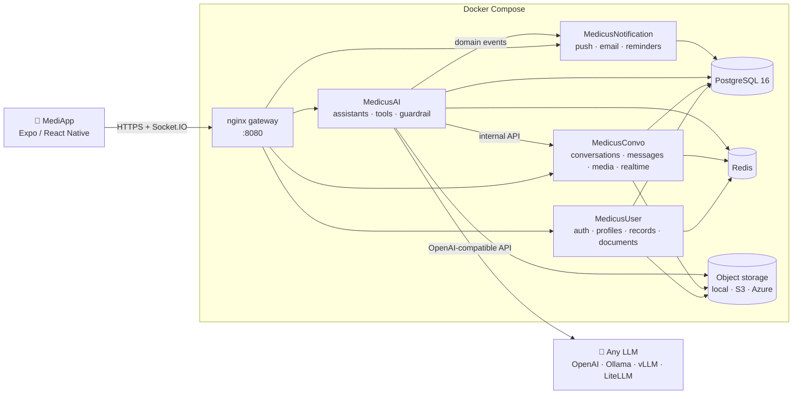

<div align="center">

# Medicus

**An open-source, AI-assisted healthcare platform that connects patients and doctors, with any LLM you choose.**

Patients chat with an assistant that knows their health record. Doctors chart, prescribe and book by talking to theirs. You decide which model runs it: OpenAI, Anthropic, Gemini, or a local model on your own hardware through Ollama or vLLM.

[](LICENSE)
[](https://www.python.org/)
[](https://www.postgresql.org/)
[](https://expo.dev/)
[](docker-compose.yml)
[](CONTRIBUTING.md)

[Features](#features) · [Quick start](#quick-start) · [Choosing a model](#choosing-a-language-model) · [Architecture](#architecture) · [Configuration](#configuration) · [Contributing](#contributing)

</div>

> [!IMPORTANT]
> Medicus is **not a medical device** and does not replace professional medical judgement. It ships with security controls for health data, but it is **not certified** for HIPAA, GDPR or any other regulatory regime out of the box. If you deploy it with real patients, compliance is your responsibility. See [Security](#security).

---

## Table of contents

- [Why Medicus](#why-medicus)
- [Features](#features)
- [Quick start](#quick-start)
- [Choosing a language model](#choosing-a-language-model)
- [Running the mobile app](#running-the-mobile-app)
- [Architecture](#architecture)
- [Project structure](#project-structure)
- [Configuration](#configuration)
- [Database](#database)
- [Testing](#testing)
- [Security](#security)
- [Roadmap](#roadmap)
- [Contributing](#contributing)
- [License](#license)

## Why Medicus

Most AI health assistants are closed products that send your data to a single vendor. Medicus takes the opposite approach:

- **Bring your own model.** Every AI feature goes through one provider-neutral layer. Switch from GPT to Claude to a local Qwen model by changing environment variables, not code.
- **Self-host anywhere.** Plain PostgreSQL, Redis and Docker. No cloud account is required: storage, email and push notifications all have local or self-hosted options.
- **Grounded answers.** Assistants don't guess. They call tools that read the patient's actual record (vitals, conditions, medications, visits) and write back to it in a structured, auditable way.
- **Security by construction.** The model never decides *whose* data it touches. Patient and doctor identity are resolved on the server and injected into every tool call.

## Features

### For patients: the **MediAid** assistant
- Ask about your own record in plain language: latest vitals, active conditions, current medications, upcoming procedures and exams.
- Find a doctor's free slots and book, reschedule or cancel appointments in conversation.
- Message your doctor directly, with real-time delivery over Socket.IO.
- Send voice notes (speech-to-text) and attachments such as lab reports and PDFs, which the assistant reads and explains.
- **MediExplain:** a plain-language summary of what your doctor discussed.
- A personal document vault, with documents you can share with your doctor in a conversation.
- Manage dependents (children, parents) under one account.
- An emergency triage protocol and support tickets.

### For doctors: the **MediDoc** assistant
- Chart by conversation: record vitals, diagnoses, SOAP notes, prescriptions, exam orders and results, and procedures.
- Correct records safely: notes and procedures are *superseded* or *invalidated*, never silently overwritten.
- **MediBrief:** an on-demand clinical summary of a patient thread.
- An agenda across all patients, conversation search, and practice performance metrics.
- A public profile: specialties, working hours, locations, procedures and pricing.

### Platform
- **Model-agnostic AI layer:** OpenAI, any OpenAI-compatible server (Ollama, vLLM, LM Studio, llama.cpp, OpenRouter, Groq, Together, Azure OpenAI) or 100+ providers through LiteLLM (Anthropic, Gemini, Bedrock, Mistral and more), with a different model per task if you want.
- **Prompt-injection guardrail** on every user turn (optional).
- **Notifications:** Expo push, Firebase Cloud Messaging and email, with quiet hours, per-category preferences, retries, and appointment reminders 24 hours and 2 hours before.
- **Pluggable storage:** local disk, S3-compatible (AWS, MinIO, Cloudflare R2) or Azure Blob, served through short-lived signed URLs.
- **Pluggable email:** SMTP, Azure Communication Services, or console output for development.

## Quick start

**Prerequisites:** [Docker](https://docs.docker.com/get-docker/) with Compose v2, about 4 GB of free RAM, and either an API key for a hosted model or [Ollama](https://ollama.com/) for a local one.

```bash
git clone https://github.com/<your-org>/medicus.git
cd medicus
cp .env.example .env
```

Generate the required secrets and paste them into `.env`. The services refuse to start while any value still begins with `CHANGE_ME`:

```bash
openssl rand -hex 32   # JWT_SECRET_KEY
openssl rand -hex 32   # INTERNAL_API_KEY
openssl rand -hex 16   # POSTGRES_PASSWORD
```

Choose a language model in `.env` (see [Choosing a language model](#choosing-a-language-model)), then start the stack:

```bash
docker compose up -d --build                          # database, migrations, services, gateway
docker compose --profile demo run --rm seed-demo      # optional: demo doctor & patient
```

| URL | What |
|---|---|
| `http://localhost:8080` | API gateway: point the mobile app here |
| `http://localhost:8025` | Mailpit: every email the stack sends in development |

**Demo accounts** (only when you loaded `seed-demo`; never in production):

| Role | Email | Password |
|---|---|---|
| Doctor | `doctor@example.com` | `MedicusDemo123!` |
| Patient | `patient@example.com` | `MedicusDemo123!` |

Check that everything works:

```bash
python scripts/smoke_test.py      # 43 security & API checks, no LLM needed
```

## Choosing a language model

All AI features read the same few variables. Pick one option.

<details open>
<summary><b>A. OpenAI</b></summary>

```env
LLM_PROVIDER=openai
LLM_API_KEY=sk-...
```
Default models for each task are set in `MedicusCommon/medicus_common/core/config.json`.
</details>

<details>
<summary><b>B. Local models with Ollama</b> (no data leaves your machine)</summary>

Pull a model that supports **tool calling** (for example from the Qwen 3, Llama 3.1+ or Mistral families):

```bash
ollama pull qwen3.5:4b
```

Then pick where Ollama runs:

| Ollama runs… | `LLM_BASE_URL` |
|---|---|
| Natively on your machine (typical on macOS and Windows, uses the GPU) | `http://host.docker.internal:11434/v1` |
| Inside the stack: `docker compose --profile ollama up -d` | `http://ollama:11434/v1` |

```env
LLM_PROVIDER=openai_compatible
LLM_BASE_URL=http://host.docker.internal:11434/v1
LLM_API_KEY=ollama
LLM_MODEL=qwen3.5:4b
LLM_REASONING_EFFORT=none
LLM_SUPPORTS_VISION=false
```

> [!TIP]
> **Raise Ollama's context window to at least 32K tokens** (Ollama settings, or `OLLAMA_CONTEXT_LENGTH=32768`). The default of 4K is far too small: the doctor assistant's prompt, with its tools, is around 30K tokens, and Ollama **silently truncates** anything longer.
>
> Set `LLM_REASONING_EFFORT=none` for "thinking" models (Qwen 3, DeepSeek-R1, gpt-oss). Otherwise their hidden reasoning can use up the whole output budget and the reply comes back empty.

The same settings work for **vLLM, LM Studio, llama.cpp server, LocalAI, OpenRouter, Groq and Together**. Only the base URL and model name change.
</details>

<details>
<summary><b>C. Anthropic, Gemini, Bedrock, Mistral… via LiteLLM</b></summary>

```env
LLM_PROVIDER=litellm
LLM_MODEL=anthropic/claude-sonnet-4-5
ANTHROPIC_API_KEY=...
AI_COMMON_EXTRAS=ai,litellm      # build-time: installs LiteLLM into the AI service
```
</details>

**Per-task models.** Each AI task has a role, and any role can use its own model, for example a large model for the assistant and a small one for summaries:

| Variable | Used for |
|---|---|
| `LLM_MODEL_TOOLS` | The assistants themselves. **Must support tool calling.** |
| `LLM_MODEL_GUARDRAIL` | Prompt-injection screening |
| `LLM_MODEL_SUMMARY` / `LLM_MODEL_TEXT` | MediBrief, MediExplain, conversation compaction |
| `LLM_MODEL_VISION` / `LLM_MODEL_DOC` / `LLM_MODEL_LAB` / `LLM_MODEL_TRIAGE` | Attachment analysis |

A role without its own variable falls back to `LLM_MODEL`. **Speech** (voice notes) and **text-to-speech** take any server that implements `/v1/audio/transcriptions` or `/v1/audio/speech`, such as faster-whisper or Kokoro; see `STT_*` and `TTS_*` in [`.env.example`](.env.example).

## Running the mobile app

The app is built with [Expo](https://expo.dev/) (React Native). It uses native modules (WebRTC, audio), so it needs a **development build**; Expo Go is not enough.

```bash
cd MediApp
npm ci
cp .env.example .env
```

Set `EXPO_PUBLIC_MEDICUS_API_BASE_URL` in `MediApp/.env` to the gateway as the device sees it:

| Device | Base URL |
|---|---|
| Android emulator | `http://10.0.2.2:8080` |
| iOS simulator | `http://localhost:8080` |
| Physical phone (same Wi-Fi) | `http://<your-computer-LAN-IP>:8080` |

```bash
npx expo run:android      # or: npx expo run:ios   (macOS only)
```

> [!NOTE]
> Android builds need **JDK 17**. Newer JDKs, including the one bundled with recent Android Studio versions, are not supported by the project's Gradle version. Set `JAVA_HOME` to a JDK 17 install.

To publish your own build or over-the-air updates, set `EXPO_OWNER`, `EAS_PROJECT_ID` and `APP_BUNDLE_ID`; for maps, set `GOOGLE_MAPS_API_KEY`. See [`MediApp/.env.example`](MediApp/.env.example).

## Architecture



| Service | Responsibility |
|---|---|
| **MedicusUser** | Registration, login, JWT and refresh-token rotation, email verification, password reset, patient and doctor profiles, dependents, read APIs for the medical record, document vault |
| **MedicusConvo** | Conversations (patient and doctor copies of each thread), messages, uploads, signed media links, Socket.IO real-time delivery |
| **MedicusAI** | The four assistants (MediAid, MediDoc and their solo variants), about 40 database-backed tools, guardrail, speech, attachment analysis, summaries |
| **MedicusNotification** | Event-driven notifications from a Postgres-backed queue (`FOR UPDATE SKIP LOCKED`), with retries, quiet hours and reminders |
| **MedicusCommon** | Shared Python package (`medicus_common`): models, database access, the LLM provider layer, storage, email, security middleware |

**How a chat turn works.** The app sends a message to `/api/MedicusAI/chat`. The AI service **authorizes the conversation** for the logged-in user and builds a trusted scope (which patient, which doctor) from the database, ignoring any identifiers sent by the client. The agent then runs with tools whose identity parameters are **hidden from the model and injected from that scope**. A model that is tricked or confused therefore cannot read or write another patient's record.

## Project structure

```
medicus/
├── MediApp/                  # Expo / React Native mobile app
├── MedicusUser/              # FastAPI: auth, profiles, medical-record reads, documents
├── MedicusConvo/             # FastAPI: conversations, messages, media, Socket.IO
├── MedicusAI/                # FastAPI: assistants, tools, guardrail, speech
├── MedicusNotification/      # FastAPI: notification queue & delivery (+ Python SDK in sdk/)
├── MedicusCommon/            # Shared Python package `medicus_common`
├── database/
│   ├── migrations/           # dbmate SQL migrations (schema source of truth)
│   ├── seeds/                # reference data + optional demo data
│   └── tests/smoke.sql       # schema smoke test
├── deploy/nginx/             # API gateway configuration
├── scripts/                  # smoke_test.py, e2e.sh
├── tests/e2e/                # end-to-end suites (API sweep, tools, agent loop, real-LLM chat)
├── docker-compose.yml
└── .env.example              # every configuration option, documented
```

## Configuration

Every option is documented inline in [`.env.example`](.env.example). The most important ones:

| Area | Variables | Default |
|---|---|---|
| Secrets | `JWT_SECRET_KEY`, `INTERNAL_API_KEY`, `POSTGRES_PASSWORD` | **required** |
| Language model | `LLM_PROVIDER`, `LLM_BASE_URL`, `LLM_API_KEY`, `LLM_MODEL`, `LLM_MODEL_<ROLE>` | `openai` |
| Storage | `STORAGE_BACKEND` = `local` \| `s3` \| `azure`, `STORAGE_BUCKET`, `S3_*` | `local` |
| Email | `EMAIL_BACKEND` = `smtp` \| `azure` \| `console` \| `none`, `SMTP_*` | `smtp` → Mailpit |
| Push | `EXPO_ACCESS_TOKEN`, `FCM_CREDENTIALS_PATH` | optional |
| Database | `POSTGRES_HOST`, `POSTGRES_SSL_MODE` (`verify-full` for managed databases) | bundled Postgres |
| Hardening | `CORS_ORIGINS`, `AUTH_RATE_LIMIT`, `AUTH_RATE_WINDOW_SECONDS` | see file |

**Bring your own Postgres** (RDS, Cloud SQL, Supabase, Neon…): point `POSTGRES_*` at it, set `POSTGRES_SSL_MODE=verify-full`, and the `migrate` service creates the schema. The required extensions are `pgcrypto`, `pg_trgm` and `btree_gist`.

## Database

The schema lives in plain SQL under [`database/migrations`](database/migrations) and is applied by [dbmate](https://github.com/amacneil/dbmate). Docker Compose runs the migrations automatically before any service starts.

```bash
docker compose run --rm migrate                      # apply pending migrations
docker compose run --rm migrate --migrations-dir /db/migrations rollback   # undo the latest one
docker compose --profile demo run --rm seed-demo     # demo data (idempotent)
```

The data is split into schemas by domain: `auth`, `public` (patients, doctors, clinical records), `dialog` (conversations), `docs`, `notif`, `support`, `insights` and `audit`. A database exclusion constraint makes double-booking a doctor impossible.

To change the schema, add a new file `database/migrations/YYYYMMDDHHMMSS_description.sql` with `-- migrate:up` and `-- migrate:down` sections. **Never edit a migration that has already been released.**

## Testing

| Command | What it covers | Needs an LLM? |
|---|---|---|
| `python scripts/smoke_test.py` | 43 checks: auth, authorization (IDOR), uploads, signed links, notifications, gateway rules | No |
| `./scripts/e2e.sh` | Smoke test + every User/Convo/AI endpoint + all assistant tools against the database + a full agent turn against a mock LLM | No |
| `python tests/e2e/real_llm_chat.py` | Real assistant conversations (records, booking, charting, prompt injection) against your configured model | Yes |
| `psql -f database/tests/smoke.sql` | Every view compiles, fuzzy search, the double-booking constraint | No |

The end-to-end suites expect the demo data to be loaded.

## Security

Medicus handles protected health information, so security is built into the architecture:

- **Server-side authorization everywhere.** Every record, conversation, document and media file is checked against the logged-in user; IDs sent by the client are never trusted.
- **Tool guard.** Patient and doctor identity are injected into tool calls from the server, so the model cannot choose whose data a tool touches.
- **Auth hardening:** refresh-token rotation with reuse detection, token revocation on logout, hashed verification codes with attempt limits, per-IP rate limits, account lockout.
- **CSRF protection** for cookie-based clients; bearer tokens for the mobile app.
- **Short-lived signed URLs** for files; internal service APIs are blocked at the gateway and protected by a shared key.
- **No patient data in logs** by default. Debug tracing of agent turns requires `MEDICUS_DEBUG_TRACE=true` and cannot be enabled in production.

Found a vulnerability? **Please do not open a public issue.** Follow [SECURITY.md](SECURITY.md) to report it privately.

## Roadmap

- [ ] Leaner tool definitions and per-turn tool selection, for faster small local models
- [ ] Web dashboard for doctors
- [ ] FHIR import and export
- [ ] Helm chart for Kubernetes
- [ ] More languages in the assistants and the app

Have an idea? [Open a discussion](../../discussions) or upvote an existing issue.

## Contributing

Contributions of every size are welcome: bug reports, documentation, translations, new tools for the assistants, new storage or notification providers.

1. Read [CONTRIBUTING.md](CONTRIBUTING.md) for the development setup and conventions.
2. Look for issues labelled **good first issue**.
3. Open a pull request. Run `./scripts/e2e.sh` before you submit.

Please follow our [Code of Conduct](CODE_OF_CONDUCT.md).

## License

Medicus is licensed under the [Apache License 2.0](LICENSE).

---

<div align="center">
<sub>Built with FastAPI · PostgreSQL · OpenAI Agents SDK · Expo. If Medicus is useful to you, please consider giving it a ⭐.</sub>
</div>
